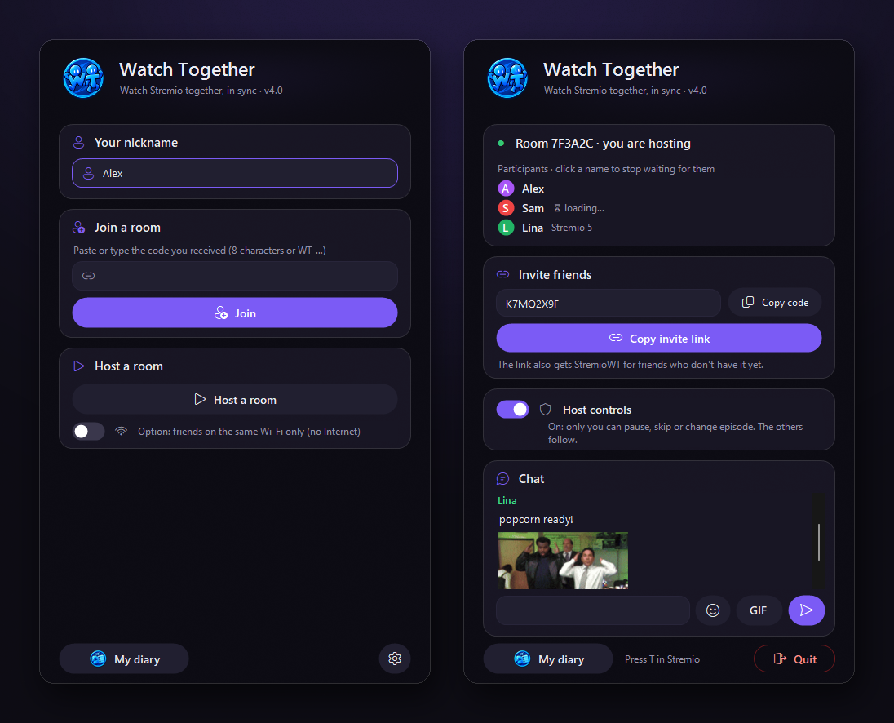
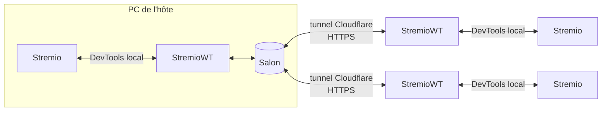

<div align="center">


# Stremio Watch Together

**Regardez films et séries avec vos amis sur Stremio, parfaitement synchronisés.**
Une petite appli, un code d'invitation, sans compte, sans serveur.

[](https://github.com/ilysay/stremio-watch-together/releases/latest)


[](linux/README.md)


[](LICENSE)

[English](README.md)



</div>

## En vidéo

https://github.com/user-attachments/assets/a3c3443b-5663-4645-815f-d716168c4983

## Pourquoi

Stremio n'a pas de soirée film à plusieurs, et partager son écran sur Discord dégrade l'image et le son.
**Stremio Watch Together** synchronise plutôt le Stremio de chacun : tout le monde regarde en pleine qualité sur son propre PC, et les pauses, la lecture, les déplacements et les changements d'épisode sont répercutés instantanément à tout le salon.

## Fonctionnalités

- 🎬 **Vraie synchro** : lecture, pause, déplacement et épisode suivant suivent le salon, avec recalage automatique.
- 🔗 **Rejoindre en un clic** : l'hôte copie un code d'invitation (`WT-…`), les amis le collent, c'est tout. Si le code est déjà dans le presse-papier, ouvrir l'appli suffit pour entrer.
- ⏳ **Attend ceux qui chargent** : si le flux de quelqu'un charge, tout le monde se met en pause et reprend ensemble. Un garde-fou de 30 secondes et un clic « ne pas l'attendre » évitent de bloquer la soirée.
- 👑 **Contrôle de l'hôte** : un interrupteur, et seul l'hôte peut mettre pause, avancer ou changer d'épisode.
- 💬 **Chat avec émotes et GIF**, dans la fenêtre et par-dessus la vidéo (touche **T** dans Stremio).
- 🛡️ **Les sources privées restent privées** : les liens Real-Debrid ou d'autres débrideurs ne sont jamais envoyés au salon. Les amis reçoivent l'épisode et choisissent leur propre source.
- 📔 **Mon journal** : tout ce que vous regardez (films, séries, animes) est noté avec affiches et notes. Les films s'exportent vers Letterboxd en un clic.
- 🌍 **10 langues** : English, Français, Español, Português, 中文, हिन्दी, العربية, বাংলা, Русский, Bahasa Indonesia.
- 🪶 **Léger et portable** : un seul `.exe` d'environ 450 Ko, rien à installer ni à configurer.

## Démarrage rapide

> [!TIP]
> **🐧 Nouveau : la bêta Linux !** Amis sous Linux et sous Windows peuvent partager le même salon. [Version Linux](linux/README.md) (page en anglais). C'est une bêta, donc **vos retours sont les bienvenus** : [ouvrez une issue](https://github.com/ilysay/stremio-watch-together/issues) pour nous dire comment ça s'est passé.

**Il faut :** Windows 10 ou 11 et l'[application Stremio pour PC](https://www.stremio.com/downloads) officielle : Stremio 5 (la version actuelle) ou Stremio 4.

### Organiser une soirée
1. [Téléchargez `StremioWT.exe`](https://github.com/ilysay/stremio-watch-together/releases/latest) et double-cliquez dessus.
2. Cliquez sur **Héberger un salon** : le code d'invitation est copié.
3. Collez-le à vos amis (Discord, WhatsApp…), puis lancez un film dans Stremio.

### Rejoindre un ami
1. Copiez le code d'invitation reçu.
2. Double-cliquez sur `StremioWT.exe`. C'est tout : l'appli lit le code et rejoint le salon.

> Stremio redémarre une fois en mode « Watch Together » quand vous rejoignez ou hébergez. Gardez la petite fenêtre ouverte (réduite si vous voulez) pendant le film. L'appli démarre en anglais : ⚙ > **Language** > Français.

## Comment ça marche



- **L'appli de l'hôte fait tourner le salon** elle-même et ouvre un [tunnel Cloudflare](https://developers.cloudflare.com/cloudflare-one/connections/connect-networks/do-more-with-tunnels/trycloudflare/) gratuit et temporaire. Pas de compte ni de serveur tiers, et le salon disparaît quand l'hôte ferme l'appli.
- Sur chaque PC, StremioWT dialogue avec Stremio par son port de débogage **local** et y injecte un petit script qui détecte et applique lecture, pause, déplacements et changements d'épisode.
- Seuls de **petits messages de contrôle** passent par le salon (« pause à 12:34 », « ouvre l'épisode S2E5 »…), jamais la vidéo : chacun regarde depuis son propre Stremio.

## Vie privée et sécurité

| | |
|---|---|
| 🙈 **Adresses IP** | Les amis passent par Cloudflare : personne dans le salon ne voit l'IP de l'hôte ni celle des autres. |
| 🔒 **Liens de débrideur** | Les liens Real-Debrid et autres sources privées ne sont jamais partagés, seulement l'épisode. |
| 🧾 **Sans compte** | Pas d'inscription, pas de connexion, rien de stocké sur vous sur un serveur. |
| 💬 **Chat** | Texte simple (300 caractères max), 5 messages par 10 s. Les GIF ne viennent que de Giphy et Tenor : un lien ne peut pas servir à récupérer l'IP des spectateurs. |
| 📊 **Statistiques anonymes** | L'appli envoie un identifiant d'installation aléatoire, la version, la langue, la taille du salon, des codes d'erreur et la durée arrondie des séances, pour compter les utilisateurs et repérer les bugs. Jamais de pseudo, titre, lien, message ni IP. Désactivable dans ⚙ **Paramètres**. Le [code du serveur](telemetry/worker.js) est public. |
| 🐞 **Rapports de bug** | Seulement si vous cliquez sur **Signaler un bug** (dans ⚙ **Paramètres** ou sous une erreur) puis sur **Envoyer**. Vous voyez d'abord exactement ce qui part : votre message, les versions de l'appli et du système, et le journal de l'appli (il peut contenir votre pseudo et les titres regardés). Gardé 30 jours, jamais partagé. |
| 🔍 **Open source** | Tout le code est ici, sous licence MIT. L'exe de chaque version est compilé à partir de ce code. |

**« Windows a protégé votre ordinateur » ?** L'exe n'est pas signé (une signature coûte quelques centaines d'euros par an), donc SmartScreen prévient pour tout nouveau téléchargement. Cliquez sur **Informations complémentaires → Exécuter quand même**. Vous pouvez aussi le compiler vous-même (voir plus bas) ou comparer son empreinte SHA-256 avec celle indiquée dans la version :

```powershell
Get-FileHash .\StremioWT.exe -Algorithm SHA256
```

**Antivirus :** [VirusTotal](https://www.virustotal.com/gui/file/a41f938558bddb85695cba07b26a50bfd9ce48799bdd358ee6dffd2b535971a0) indique 1/71, une estimation de l'IA de Malwarebytes (`MachineLearning/Anomalous`), fréquente pour les nouveaux outils non signés. Elle est en cours de signalement à Malwarebytes comme faux positif. Les 70 autres antivirus, dont Microsoft Defender, ne détectent rien.

## FAQ

<details>
<summary><b>« Stremio introuvable » ?</b></summary>

StremioWT pilote l'**application Stremio pour PC**, il doit donc d'abord la trouver. Il cherche un Stremio déjà ouvert, puis dans les dossiers d'installation habituels (`AppData\Local\Programs\Stremio`, `Program Files`…). Ce message apparaît quand :

- **Vous utilisez Stremio seulement dans le navigateur** (web.stremio.com) ou sur téléphone/TV : installez l'[application Stremio pour Windows](https://www.stremio.com/downloads), gratuite. La version web ne peut pas être synchronisée.
- **Stremio est installé à un endroit inhabituel** (autre disque, version portable…) : **ouvrez d'abord Stremio, puis StremioWT**. Il détecte le Stremio ouvert où qu'il soit et s'en souvient pour la suite.
</details>

<details>
<summary><b>Tout le monde doit avoir Real-Debrid ?</b></summary>

Non, chacun choisit sa source. Si l'hôte lance un lien Real-Debrid, les amis arrivent sur la page de l'épisode avec un bandeau qui leur demande de choisir une source, et le salon les recale dès qu'ils la lancent.
</details>

<details>
<summary><b>Ça marche avec les addons HTTP / débrideurs ?</b></summary>

Oui. Les liens directs ne sont volontairement pas partagés : ils contiennent souvent votre clé de débrideur et ne marchent en général que chez vous. Les amis arrivent sur le même épisode, choisissent leur source, et le salon les garde synchronisés.
</details>

<details>
<summary><b>Pourquoi mon ami a quelques minutes d'avance alors qu'on est synchronisés ?</b></summary>

Vous avez sûrement pris des versions différentes (autre montage, ou version à 25 images/s plus courte). La synchro suit le minutage : prenez la même source, même nom et même taille. L'appli prévient quand la durée de votre vidéo ne correspond pas à celle de l'hôte.
</details>

<details>
<summary><b>Et si le flux de quelqu'un est lent ?</b></summary>

Le salon se met en pause pendant son chargement et reprend ensemble. Au-delà de 30 secondes, on ne l'attend plus. L'hôte peut aussi cliquer sur un pseudo pour ne jamais attendre cette personne.
</details>

<details>
<summary><b>Ça marche sur le même wifi sans Internet ?</b></summary>

Oui : cochez « amis sur le même wifi seulement » avant d'héberger. Aucun tunnel n'est ouvert.
</details>

<details>
<summary><b>Sur Linux, Mac ou téléphone ?</b></summary>

**Linux : oui, en bêta !** Voir la [page Linux](linux/README.md). Amis sous Linux et sous Windows peuvent être dans le même salon. Mac et téléphone : pas pour l'instant. Des amis sur Stremio 4 et Stremio 5 peuvent partager le même salon.
</details>

## Compiler soi-même

Il faut le [SDK .NET](https://dotnet.microsoft.com/download) (l'appli vise .NET Framework 4.8, inclus dans Windows).

```powershell
git clone https://github.com/ilysay/stremio-watch-together.git
cd stremio-watch-together
.\scripts\build.ps1      # lance les tests puis compile StremioWT.exe
```

L'organisation du code est décrite dans le [README anglais](README.md#build-from-source).

## Licence

Si le projet vous plaît, une ⭐ sur GitHub aide vraiment à le faire connaître.

[MIT](LICENSE). Les contributions et signalements de bugs sont les bienvenus dans les [issues](https://github.com/ilysay/stremio-watch-together/issues).

<sub>Stremio Watch Together est un projet indépendant, sans lien avec Stremio. Il n'héberge, ne fournit ni ne référence aucun contenu : il synchronise seulement ce que chacun lance déjà dans son propre Stremio.</sub>
