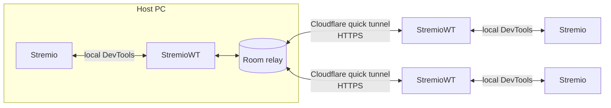

<div align="center">


# Stremio Watch Together

**Watch movies and series with your friends on Stremio, perfectly in sync.**
One tiny app, one invite code, no account, no server.

[](https://github.com/ilysay/stremio-watch-together/releases/latest)


[](linux/README.md)
[](mac/README.md)


[](LICENSE)

[Français](README.fr.md)


</div>

## Download

| | |
|---|---|
| 🪟 **Windows** | **[Download StremioWT.exe](https://github.com/ilysay/stremio-watch-together/releases/latest/download/StremioWT.exe)** and double-click it. Needs the [Stremio app for Windows](https://www.stremio.com/downloads). |
| 🐧 **Linux** (beta) | **[Download StremioWT-linux-x64](https://github.com/ilysay/stremio-watch-together/releases/latest/download/StremioWT-linux-x64)**, then follow the **[Linux guide](linux/README.md)** (one install script). |
| 🍎 **Mac** (test version, may be buggy) | **[Download StremioWT-mac.zip](https://github.com/ilysay/stremio-watch-together/releases/latest/download/StremioWT-mac.zip)** (Apple Silicon and Intel), then follow the **[Mac guide](mac/README.md)**. Needs Chrome, Edge or Brave. |

## See it in action

https://github.com/user-attachments/assets/d6ba2f92-6f26-4fec-a811-aa4ec20408ba

## Why

Stremio has no watch party. Screen sharing on Discord kills the quality and the sound sync.
**Stremio Watch Together** keeps everyone's own Stremio in sync instead: each person streams in full quality on their own PC, and pause, play, seek and episode changes are mirrored to the whole room instantly.

## Features

- 🎬 **Real sync**: play, pause, seek and next episode follow the room, with automatic catch-up.
- 🧩 **Right inside Stremio**: Stremio opens with a **Watch Together** button. Host, join, invite and see who's there without leaving Stremio; the small StremioWT window steps aside.
- 🔗 **Join in one click**: the host sends an invite link. Friends without the app land on a page that gets them the right download (Windows, Linux or Mac) and joins the room as soon as they open it; friends who have it go straight in. Friends who have the app can also just type the room's short code, like `K7MQ2X9F`.
- 🔄 **Updates in one click**: when a new version is out, the app downloads it from GitHub, checks its SHA-256 fingerprint and restarts.
- ⏳ **Waits for slow loaders**: when someone's stream is buffering, everyone pauses and resumes together. A 30-second safeguard and a "don't wait for them" click keep the night going.
- 🐢 **Slow source alert**: if someone's torrent is too slow, or finds no peers at all, everyone is told to pick a source with more seeds (or Real-Debrid).
- 🛟 **Survives a Stremio crash**: the room stays open, friends are told, and a **Restart Stremio** button brings you back in sync.
- 👑 **Host controls**: one switch and only the host can pause, seek or change episode.
- 👀 **See everyone's Stremio version** next to their name, with a heads-up when versions don't open torrents the same way.
- 💬 **Chat with emotes and GIFs**, in the window and right over the video (press **T** in Stremio).
- 🛡️ **Private sources stay private**: Real-Debrid and other debrid links are never sent to the room. Friends get the episode and pick their own source.
- 📔 **My diary**: everything you watch (movies, series, anime) is logged with posters and ratings. Movies export to Letterboxd in one click.
- 🌍 **15 languages**, picked automatically from your computer's language: English, Français, Español, Português, Deutsch, Italiano, Türkçe, Polski, Čeština, Русский, 中文, हिन्दी, العربية, বাংলা, Bahasa Indonesia.
- 🪶 **Tiny and portable**: a single ~800 KB `.exe`, nothing to install, nothing to configure.

## Quick start

> [!TIP]
> **🐧 On Linux?** Follow the **[Linux guide](linux/README.md)** instead. Linux and Windows friends can share the same room. It's a beta, so **feedback is very welcome**: [open an issue](https://github.com/ilysay/stremio-watch-together/issues) and tell us how it went.
>
> **🍎 On a Mac?** There's a **test version**: see the **[Mac guide](mac/README.md)**. It's not stable yet and may have bugs, so bug reports are gold.

**You need (Windows):** Windows 10 or 11 and the official [Stremio desktop app](https://www.stremio.com/downloads): Stremio 5 (the current version) or Stremio 4.

### Host a movie night
1. [Download `StremioWT.exe`](https://github.com/ilysay/stremio-watch-together/releases/latest) and double-click it.
2. Click **Host a room**, in the app or with the **Watch Together** button inside Stremio. The invite link is copied for you, and the room's short code (like `K7MQ2X9F`) is shown.
3. Send the link or the code to your friends (Discord, WhatsApp…), then start any movie in Stremio.

### Join a friend
1. Click the invite link your friend sent you, or copy their code.
2. Double-click `StremioWT.exe`. It reads a copied code and joins by itself. You can also type the short code in **Join a room**.

> When you open StremioWT, Stremio restarts once in "Watch Together" mode, with the **Watch Together** button inside. Keep StremioWT open during the movie (it minimizes itself).

## How it works



- The **host's app runs the room** itself and opens a free, temporary [Cloudflare quick tunnel](https://developers.cloudflare.com/cloudflare-one/connections/connect-networks/do-more-with-tunnels/trycloudflare/). No account and no third-party server are involved, and the room disappears when the host closes the app.
- On each PC, StremioWT talks to Stremio through its **local** debugging port and injects a small script that detects and applies play, pause, seek and episode changes.
- Only **small control messages** travel through the room (`pause at 12:34`, `open episode S2E5`…). The video never does: everyone streams from their own Stremio.

## Privacy & security

| | |
|---|---|
| 🙈 **IP addresses** | Friends connect through Cloudflare. Nobody in the room sees the host's IP or each other's. |
| 🔒 **Debrid links** | Links from Real-Debrid and other private sources are never shared. Only the episode is. |
| 🧾 **No account** | No sign-up, no login, nothing stored about you on any server. |
| 💬 **Chat** | Plain text only (300 characters max), 5 messages per 10 s. GIFs are only shown from Giphy and Tenor, so a link can't be used to grab viewers' IPs. |
| 📊 **Anonymous stats** | The app sends a random install ID, the version, the language, room size, error codes and rounded session length to count users and spot bugs. Never names, titles, links, chat messages or IPs. Turn it off in ⚙ **Settings**. The [server code](telemetry/worker.js) is public. |
| 🐞 **Bug reports** | Only if you click **Report a bug** (in ⚙ **Settings** or under an error) and then **Send**. You see exactly what's sent first: your message, your app and system versions, and the app log (which may include your nickname and titles you watched). Kept 30 days, never shared. |
| 🔍 **Open source** | Every line is here, under the MIT license. The exe in each release is built from this code. |

**"Windows protected your PC"?** The exe isn't code-signed (signing costs a few hundred euros a year), so SmartScreen warns about any new download. Click **More info → Run anyway**. You can also build it yourself from source (see below) or compare the SHA-256 checksum listed in the release notes:

```powershell
Get-FileHash .\StremioWT.exe -Algorithm SHA256
```

**Antivirus:** [VirusTotal](https://www.virustotal.com/gui/file/a41f938558bddb85695cba07b26a50bfd9ce48799bdd358ee6dffd2b535971a0) shows 1/71, a Malwarebytes machine-learning guess (`MachineLearning/Anomalous`) typical of new, unsigned tools. It is being reported to Malwarebytes as a false positive. All 70 other engines, including Microsoft Defender, find nothing.

## FAQ

<details>
<summary><b>"Stremio not found"?</b></summary>

StremioWT drives the **Stremio desktop app** on your PC, so it has to find it first. It looks for a Stremio that's already open, then in the usual install folders (`AppData\Local\Programs\Stremio`, `Program Files`…). You get this message when:

- **You only use Stremio in the browser** (web.stremio.com) or on a phone/TV: install the free [Stremio app for Windows](https://www.stremio.com/downloads). The web version can't be synced.
- **Stremio is installed somewhere unusual** (another drive, a portable copy…): just **open Stremio first, then StremioWT**. It detects the running Stremio wherever it is and remembers it for next time.
</details>

<details>
<summary><b>Does everyone need Real-Debrid?</b></summary>

No. Each person picks their own source. If the host plays a Real-Debrid link, friends land on the episode page with a banner asking them to choose a source, and the room follows as soon as they start it.
</details>

<details>
<summary><b>Does it work with HTTP / debrid addons?</b></summary>

Yes. Direct links aren't shared on purpose: they often contain your private debrid key and usually only work for you. Friends land on the same episode, pick their own source, and the room keeps them in sync.
</details>

<details>
<summary><b>Why is my friend a few minutes ahead even though we're synced?</b></summary>

You probably picked different releases (another cut, or a 25 fps version that runs shorter). Sync follows the timestamp, so pick the same source, same name and size. The app warns you when your video length doesn't match the host's.
</details>

<details>
<summary><b>What if someone's stream is slow?</b></summary>

The room pauses while they load and resumes together. After 30 seconds it stops waiting for them. The host can also click a name in the participants list so the room never waits for that person.
</details>

<details>
<summary><b>Can I use it on the same Wi-Fi without Internet?</b></summary>

Yes, turn on "friends on the same Wi-Fi only" before hosting. No tunnel is opened.
</details>

<details>
<summary><b>Does it work on Linux, Mac or phone?</b></summary>

**Linux: yes, in beta!** See the [Linux page](linux/README.md). **Mac: a test version is out**, not stable yet: see the [Mac page](mac/README.md). Windows, Linux and Mac friends can be in the same room. Phones: not for now. Friends on Stremio 4 and Stremio 5 can share the same room.
</details>

<details>
<summary><b>How do I change the language?</b></summary>

⚙ at the bottom right of the home screen, then **Language**. The app restarts in the new language, including the texts shown inside Stremio.
</details>

## Build from source

You need the [.NET SDK](https://dotnet.microsoft.com/download) (the app itself targets .NET Framework 4.8, which ships with Windows).

```powershell
git clone https://github.com/ilysay/stremio-watch-together.git
cd stremio-watch-together
.\scripts\build.ps1      # runs the tests, then builds StremioWT.exe
```

| Folder | What's inside |
|---|---|
| `src/Network` | Room relay (HTTP long polling) and Cloudflare tunnel |
| `src/Stremio` | Stremio launcher, minimal DevTools client, script injected into Stremio |
| `src/Session` | A watch session: sync, waiting for loaders, chat, ratings |
| `src/UI`, `src/Chat`, `src/Journal` | Windows Forms interface, chat, diary and Letterboxd export |
| `src/Localization` | The 15 languages |
| `tests` | Unit and relay tests (`dotnet test`) |
| `telemetry` | Cloudflare Worker for anonymous stats and GIF search |

## License

If you like it, a ⭐ on GitHub really helps others find it.

[MIT](LICENSE). Contributions and bug reports are welcome in the [issues](https://github.com/ilysay/stremio-watch-together/issues).

<sub>Stremio Watch Together is an independent project, not affiliated with Stremio. It doesn't host, provide or index any content: it only syncs what each person already plays in their own Stremio.</sub>
