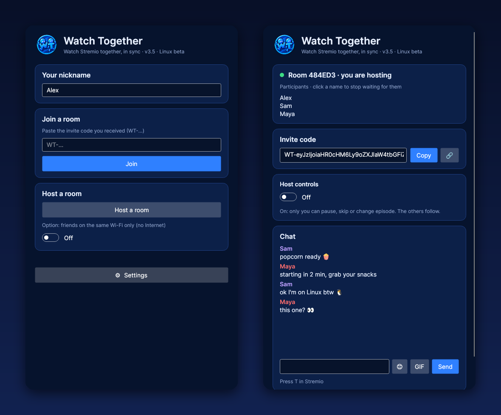
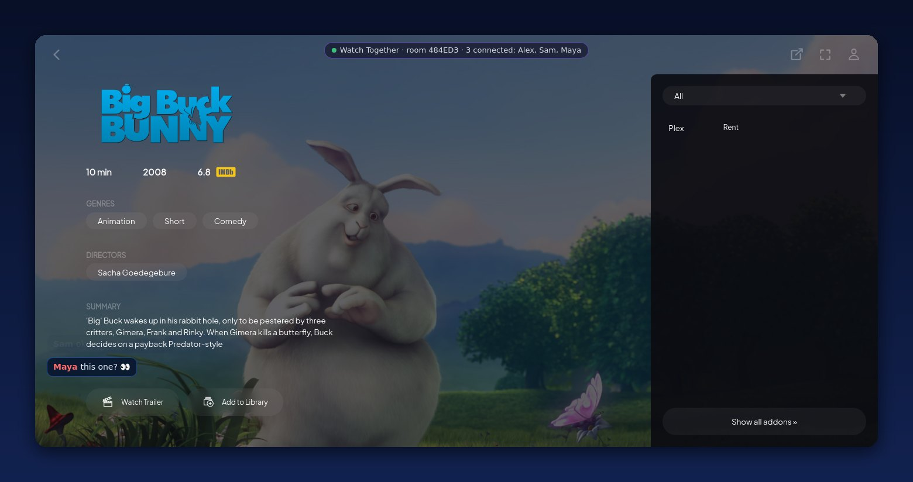

<div align="center">


# Stremio Watch Together for Linux

**Watch Stremio with your friends from Linux, perfectly in sync.**
Same rooms, same invite codes: Linux and Windows friends watch together.

[](https://github.com/ilysay/stremio-watch-together/releases/latest)


-0c2048?style=flat-square)




</div>

> [!NOTE]
> **This is a beta, and your feedback is very welcome!** Rooms, invites, chat and sync are tested between Linux and Windows, but video playback on real Linux PCs still needs confirming, and Linux setups are all different. Whether it worked perfectly or not at all, [open an issue](https://github.com/ilysay/stremio-watch-together/issues) and tell us your distro and desktop (attach your log file if something broke, see [Problems?](#problems)). Every report helps.

## What you get

- 🎬 **Real sync**: play, pause, seek and next episode follow the whole room.
- 🐧 **Linux ↔ Windows**: one invite code works for everyone, whatever their system.
- 🔗 **Join in one click**: copy the code (`WT-…`), open the app, you're in.
- 💬 **Chat and emotes**, in the window and right over the video (press **T** in Stremio).
- 👑 **Host controls**: one switch and only the host can pause, seek or change episode.
- 🛡️ **Private sources stay private**: debrid links are never sent. Friends get the title and pick their own source.
- 📦 **One file**: nothing to install, .NET is included.

<div align="center">

<br><sub>The room bar and the chat, right inside Stremio.</sub>
</div>

## Install

**1.** Install **Stremio 4 for Linux**, if you don't have it. The **Flatpak** is the most reliable (the `.deb` from [stremio.com/downloads](https://www.stremio.com/downloads) can fail on recent Ubuntu):

```bash
sudo apt install flatpak
flatpak remote-add --if-not-exists flathub https://flathub.org/repo/flathub.flatpakrepo
flatpak install flathub com.stremio.Stremio
```

(On Fedora, Mint or Pop!_OS, Flatpak is already there: only the last line is needed.) Open Stremio once and log in.

**2.** Download **StremioWT** and open it:

```bash
wget https://github.com/ilysay/stremio-watch-together/releases/latest/download/StremioWT-linux-x64
chmod +x StremioWT-linux-x64
./StremioWT-linux-x64
```

That's it. The app finds Stremio by itself and opens it in Watch Together mode.

## How to use it

| | Host | Friends |
|---|---|---|
| **1** | Click **Host a room** | Get the code from the host |
| **2** | The invite code is copied: send it | Copy it and open the app: it joins by itself |
| **3** | Pick something in Stremio | Everyone's Stremio follows |

Keep the app open during the movie (you can minimize it).

## Build it yourself

You need git and the [.NET 9 SDK](https://dot.net) (`sudo apt install dotnet-sdk-9.0` on Ubuntu).

```bash
git clone https://github.com/ilysay/stremio-watch-together.git
cd stremio-watch-together
dotnet publish linux/StremioWT.Linux.csproj -c Release -r linux-x64 --self-contained -p:PublishSingleFile=true -o out
./out/StremioWT
```

On ARM (Raspberry Pi…), use `-r linux-arm64`.

## Not in the beta yet

| Feature | Windows | Linux beta |
|---|:---:|:---:|
| Rooms, sync, invites | ✅ | ✅ |
| Chat and emotes | ✅ | ✅ |
| Animated GIFs in the chat | ✅ | first frame only |
| My diary + Letterboxd export | ✅ | coming |
| Stremio 5 | ✅ | not on Linux yet (Stremio 4 is used) |

## Problems?

<details>
<summary><b>"Stremio not found"</b></summary>

Install Stremio 4 (`.deb` or Flatpak), then reopen the app. Supported places: `/usr/bin/stremio`, `/opt/stremio`, `~/.local/bin/stremio` and the Flatpak `com.stremio.Stremio`.
</details>

<details>
<summary><b>My friends can't join</b></summary>

The first time you host, the app downloads `cloudflared` (Cloudflare's official tool, ~60 MB) to open the room to the Internet. Wait for it to finish. If you're all on the same Wi-Fi, tick **same Wi-Fi only** instead.
</details>

<details>
<summary><b>Something else</b></summary>

Click **🐞 Report a bug** in ⚙ Settings (or under the error message): you see exactly what's sent before sending. Or open an issue and attach `~/.local/share/StremioWT/log.txt`.
</details>

<details>
<summary><b>Uninstall</b></summary>

Delete the app file and the folder `~/.local/share/StremioWT/` (settings, log and `cloudflared`).
</details>

---

<div align="center">
<sub>Made with 🍿 for movie nights. <a href="../README.md">Back to the main page</a></sub>
</div>
